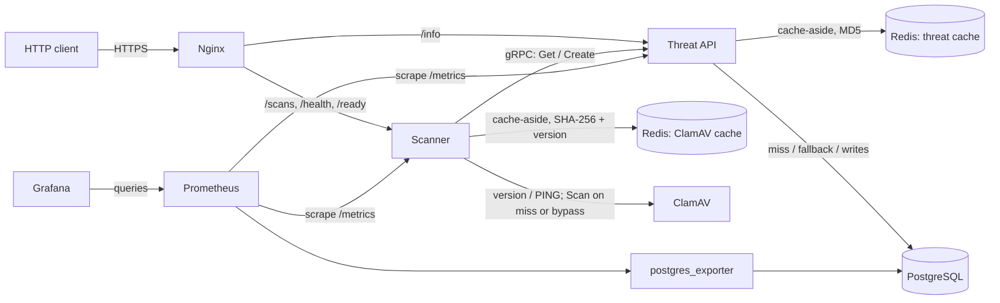

# threat_service

## Overview

Go backend для хранения информации об угрозах по MD5 и проверки загружаемых
файлов. Threat API предоставляет REST и gRPC поверх PostgreSQL. Отдельный HTTP
Scanner вычисляет хеши файла, получает вердикт ClamAV и дополняет его сведениями
каталога через gRPC. Redis уменьшает число SQL SELECT и повторных проверок ClamAV.

## Tech Stack

Go 1.27.1, chi, REST API, gRPC / Protocol Buffers, PostgreSQL 16 / pgx,
golang-migrate, Redis 7.4, ClamAV 1.4, Docker / Docker Compose, Nginx,
Prometheus, Grafana, k6; unit, integration и E2E tests.

## Architecture



Оба кэша используют один Redis с разными префиксами ключей. Compose объединяет
три фрагмента через `include`. Общая сеть соединяет API, Scanner, Redis и
мониторинг; ClamAV доступен только в отдельной сети Scanner. PostgreSQL должен
стать healthy, миграции — успешно завершиться перед запуском API. Scanner ждёт
ClamAV, Nginx — оба Go-сервиса. Redis не входит в `depends_on` приложений:
его недоступность допускает запуск и обработку запросов через fallback.

Внутренние порты составляют топологию Compose: API HTTP `8080`, gRPC `50051`,
Scanner `8082`, PostgreSQL `5432`, ClamAV `3310`, Redis `6379`. Redis, PostgreSQL
и ClamAV не публикуют порты на хост. Опубликованные интерфейсы привязаны к loopback.

## Redis Caching

**Threat API.** Positive cache-aside по MD5: GET сначала читает Redis, при miss
обращается к PostgreSQL и кэширует найденную запись. Отсутствующие угрозы не
кэшируются. Fixed TTL с jitter (90–100% заданного TTL), без продления при чтении.
После успешного POST/PUT ключ инвалидируется; это также относится к записи через
gRPC. Ошибки Redis приводят к fallback на PostgreSQL, ошибки инвалидации видны
в логах и метриках. Общий Redis использует `allkeys-lru` и лимит памяти.

**Scanner.** Файл сначала полностью буферизуется в памяти в пределах лимита,
затем вычисляются MD5 и SHA-256. Ключ вердикта включает SHA-256, версию ClamAV
engine/signature database и `SCANNER_CACHE_POLICY_VERSION`. Версия запрашивается
у ClamAV перед lookup; если получить её нельзя, кэш обходится. Hit пропускает
`ClamAV.Scan()`, но проверка каталога по gRPC выполняется заново. Успешные
`clean` и `infected` кэшируются с TTL и jitter 90–100%; ошибка антивируса никогда
не превращается в `clean` и не кэшируется. Сбой Redis приводит к реальному
сканированию (fail-open относится только к кэшу).

Cache-aside не гарантирует строгую консистентность: параллельное чтение может
записать старое значение после инвалидации; неуспешная инвалидация оставляет запись
до TTL/eviction. Одновременные cache miss могут вызвать несколько проверок одной
зависимости. Версионирование ClamAV отделяет ключи разных версий; старые ключи
исчезают по TTL/LRU.

### Включение и отключение через ENV

В `.env` для двух независимых кэшей:

```dotenv
REDIS_ADDR=redis:6379
THREAT_CACHE_ENABLED=true
THREAT_CACHE_TTL=10m
SCANNER_CACHE_ENABLED=true
SCANNER_CACHE_TTL=1h
```

Чтобы отключить оба кэша на уровне приложения:

```dotenv
THREAT_CACHE_ENABLED=false
SCANNER_CACHE_ENABLED=false
```

После изменения `.env` выполните `make up`: Compose пересоздаст контейнеры,
конфигурация которых изменилась. Можно отключить только один кэш. Значения из
экспортированного окружения имеют приоритет над `.env`; разовый пример:

```bash
THREAT_CACHE_ENABLED=false SCANNER_CACHE_ENABLED=false make up
THREAT_CACHE_ENABLED=true SCANNER_CACHE_ENABLED=true make up
```

`make redis-down` останавливает только Redis, не меняет ENV и не останавливает
PostgreSQL, Scanner или Threat API. При включённых флагах приложения продолжают
пытаться читать/писать кэш, получают ошибки с ограниченными таймаутами и используют
PostgreSQL/ClamAV. Это может добавить задержки и предупреждения. `false` отключает
само обращение приложения к Redis. Переключение в `false` не удаляет существующие
ключи: они остаются до TTL/eviction. После `make redis-up` включённые клиенты
восстанавливают работу без перезапуска Go-сервисов.

Обычная остановка не выполняет `FLUSHALL`, не удаляет контейнеры или volumes.
У Redis намеренно выключены RDB и AOF: после перезапуска содержимое кэша теряется.
`make up` всегда запускает Redis, даже когда оба кэша отключены через ENV.

## Quick Start

Нужны Docker Desktop / Engine с Compose 2.20+ (`include`), Make и OpenSSL.
Для локальных Go-тестов нужен Go из `go.work`, для примеров запросов — curl.

```bash
cd threat_service # уже клонированный репозиторий
make init
# Отредактируйте .env: заполните DB_PASSWORD и GRAFANA_ADMIN_PASSWORD.
make config
make up
make smoke
```

`make init` копирует отсутствующий `.env` и создаёт локальный самоподписанный
TLS-сертификат. DB_URL собирается Compose из переменных БД; используйте URL-safe
пароль либо задайте URL с percent-encoded паролем отдельно. Не публикуйте `.env`
и приватный ключ. Локальные файлы исключены из Git и Docker build context.

Первый запуск ClamAV загружает сигнатуры и может занять несколько минут;
`make up` ждёт healthchecks до 900 секунд. Нужен интернет; для Docker желательно
не менее 4 GiB RAM. На Apple Silicon образ ClamAV использует эмуляцию amd64.
Повторный запуск собирает изменения, сохраняет неизменившиеся контейнеры и
перезагружает проверенную конфигурацию Nginx, включая обновлённый сертификат.

Основной адрес — `https://localhost`. Прямые интерфейсы разработки по умолчанию:
API `http://127.0.0.1:8080`, gRPC `127.0.0.1:50051`, Scanner
`http://127.0.0.1:8082`. Nginx завершает TLS, перенаправляет HTTP на HTTPS и
ограничивает запросы по IP (`10r/s`, `burst=20`, превышение — `429`).
Сервис предназначен для локальной разработки: авторизация не реализована.

### Make commands

| Команда | Назначение |
|---|---|
| `make help` / `make init` | Справка / подготовка ENV и TLS |
| `make up` / `make down` | Сборка и запуск основного стека с Redis / остановка всех профилей с сохранением volumes |
| `make restart` | Перезапуск работающих сервисов, без применения изменений ENV/Compose |
| `make ps` / `make logs` | Состояние всех контейнеров / логи приложений и прокси |
| `make config` / `make migrate` | Валидация всех профилей без печати секретов / применение миграций основной БД |
| `make redis-up` / `make redis-down` | Запуск Redis с ожиданием готовности / остановка только Redis |
| `make redis-restart` | Перезапуск Redis без применения изменений ENV |
| `make redis-logs` / `make redis-status` | Логи Redis / состояние, включая остановленный контейнер |
| `make monitoring-up` / `make monitoring-down` | Запуск мониторинга и обоих приложений / остановка только мониторинга |
| `make test` / `make integration` / `make e2e` | Unit / тесты SQL / HTTP E2E на отдельной БД |
| `make smoke` | PostgreSQL readiness, метрики API и Scanner, health/ready Scanner, HTTPS и Redis PING |

Для применения новой конфигурации используйте `make up`; для Redis отдельно —
`make redis-up`, для мониторинга — `make monitoring-up`. Обычный Compose restart
не применяет изменения ENV/Compose. Все цели работают из корня и через
`make -f /absolute/path/to/Makefile <target>` из другого каталога.

## Configuration

Полный список и пояснения — в [.env.example](.env.example). Compose явно передаёт
нужные ENV внутрь контейнеров; наличие переменной в `.env` само по себе этого
не делает. Публикация другого порта на хосте не меняет внутренние порты сервисов.

| ENV | Назначение / значение по умолчанию |
|---|---|
| `DB_USER`, `DB_NAME`, `DB_PASSWORD`, `DB_URL` | PostgreSQL; пароль обязателен, URL также используют миграции |
| `API_URL` | Внешний адрес API, `https://localhost` |
| `NGINX_HTTP_PORT`, `NGINX_HTTPS_PORT` | Порты прокси, `80` / `443`; согласуйте HTTPS-порт с `API_URL` |
| `API_HTTP_HOST_PORT`, `API_GRPC_HOST_PORT`, `SCANNER_HTTP_PORT` | Порты на хосте, `8080` / `50051` / `8082` |
| `REDIS_ADDR`, `REDIS_MAXMEMORY` | `redis:6379`, `128mb`; политика `allkeys-lru`, persistence выключен |
| `THREAT_CACHE_ENABLED`, `THREAT_CACHE_TTL` | В примере `true`, `10m`; без ENV кэш выключен |
| `SCANNER_CACHE_ENABLED`, `SCANNER_CACHE_TTL` | В примере `true`, `1h`; без ENV кэш выключен |
| `SCANNER_CACHE_REDIS_TIMEOUT`, `SCANNER_CACHE_VERSION_TIMEOUT` | `80ms`, `500ms` |
| `SCANNER_CACHE_POLICY_VERSION` | `v1`, меняйте при изменении политики сканирования |
| `THREAT_GRPC_ADDR`, `CLAMAV_ADDRESS` | `app_api:50051`, `clamav:3310` |
| `SCANNER_MAX_FILE_BYTES`, `SCANNER_MAX_CONCURRENT` | 10 MiB, 4 активных запроса до обращения в каталог |
| `SCANNER_SCAN_TIMEOUT`, `CLAMAV_TIMEOUT` | `60s`, `60s`; полный запрос / обращение к движку |
| `SCANNER_SHUTDOWN_TIMEOUT`, `SCANNER_STOP_GRACE_PERIOD` | `15s`, `20s`; оставляйте Docker запас перед SIGKILL |
| `API_STOP_GRACE_PERIOD` | `10s`, больше 5-секундного shutdown API |
| `GRAFANA_ADMIN_USER`, `GRAFANA_ADMIN_PASSWORD` | `admin`, обязательный локальный пароль |
| `PROMETHEUS_HOST_PORT`, `GRAFANA_HOST_PORT`, `PROMETHEUS_RETENTION` | `9090`, `3000`, `24h` |
| `TEST_DB_PORT`, `E2E_HOST_PORT` | Отдельные тестовые порты `5433`, `8081` |

HTTP/gRPC API слушает `:8080` / `:50051` внутри Compose; при запуске Go напрямую
`API_PORT` меняет HTTP listen address. HTTP timeouts API управляются ENV: `API_READ_HEADER_TIMEOUT=5s`,
`API_READ_TIMEOUT=15s`, `API_WRITE_TIMEOUT=120s`, `API_IDLE_TIMEOUT=60s`.
`API_SHUTDOWN_TIMEOUT=5s` задаёт общий graceful shutdown HTTP/gRPC;
`API_STOP_GRACE_PERIOD` должен быть больше. Дедлайн RPC из Scanner — 3s. Nginx proxy timeouts для
Scanner — 120s: при увеличении `SCANNER_SCAN_TIMEOUT` согласуйте их в
`infra/nginx/nginx.conf`. Остальные таймауты Scanner описаны в его README.

Именованные volumes: `pgdata`, `clamav_data`, `prometheus_data`, `grafana_data`.
Смена пароля в `.env` не меняет пароль в существующей PostgreSQL/Grafana:
учётные данные должны соответствовать уже инициализированным данным.

## API

Threat API: `POST /info`, `GET /info/{md5}`, `PUT /info/{md5}`. MD5 — 32 hex-символа,
имя до 255 символов; severity: `low`, `medium`, `high`, `critical` (по умолчанию
`low`). PostgreSQL устанавливает timestamps. Исходная спецификация и миграции
сохранены.

```bash
curl --cacert infra/nginx/certs/localhost.crt https://localhost/info \
  -H 'Content-Type: application/json' \
  -d '{"md5":"d41d8cd98f00b204e9800998ecf8427e","name":"Trojan.Test","description":"Test threat","severity":"high"}'

curl --cacert infra/nginx/certs/localhost.crt \
  https://localhost/info/d41d8cd98f00b204e9800998ecf8427e

curl --cacert infra/nginx/certs/localhost.crt -X PUT \
  https://localhost/info/d41d8cd98f00b204e9800998ecf8427e \
  -H 'Content-Type: application/json' \
  -d '{"name":"Trojan.Updated","description":"Updated description","severity":"medium"}'

curl -F "file=@/path/to/file" http://127.0.0.1:8082/scans
# Через прокси:
curl --cacert infra/nginx/certs/localhost.crt \
  -F "file=@/path/to/file" https://localhost/scans
```

Scanner: `GET /health` проверяет процесс, `GET /ready` — PING ClamAV, `GET /metrics`
— метрики. Ответ сканирования содержит MD5, SHA-256, размер, verdict, signature,
duration и статус каталога. Подробности multipart, ошибок, лимитов и отдельного
запуска — в [scanner/README.md](scanner/README.md).

## Monitoring

```bash
make monitoring-up
```

Профиль `monitoring` необязателен для бизнес-сервисов. Prometheus собирает API
`app_api:8080/metrics`, Scanner `scanner:8082/metrics`, postgres_exporter и себя.
Grafana получает `http://prometheus:9090` через provisioning; данные и существующие
дашборды сохраняются в volume. Интерфейсы: `http://localhost:9090`,
`http://localhost:3000` (порты настраиваются ENV).

Основные метрики: `threat_cache_lookups_total`, `threat_cache_set_errors_total`,
`threat_cache_invalidation_errors_total`, существующие HTTP/gRPC metrics,
`scanner_cache_lookups_total`, `scanner_cache_set_errors_total`,
`scanner_clamav_scans_total`, `scanner_clamav_duration_seconds`. Серии с labels
появляются после соответствующих событий. Отдельного Redis exporter нет:
cache metrics предоставляют приложения.

PostgreSQL загружает `pg_stat_statements`; для SQL-измерений на новой БД расширение
нужно включить вручную (`CREATE EXTENSION IF NOT EXISTS pg_stat_statements;`).
Exporter предоставляет стандартные PostgreSQL metrics; collector SQL calls из
`pg_stat_statements` здесь не настроен.

## Testing

```bash
make config
make test
go vet ./threat_api/... ./scanner/...
make integration
make e2e
make smoke # после make up; требует работающий Redis даже при отключённых кэшах
```

Unit-тесты трёх Go-модулей запускаются через workspace без Docker. SQL integration
и HTTP E2E используют отдельную PostgreSQL с tmpfs и тестовыми миграциями;
после теста удаляются только тестовые контейнеры. Основная БД не используется.
Не запускайте integration и e2e одновременно: они разделяют тестовую БД.
Если порт занят: `TEST_DB_PORT=15433 make integration`;
`TEST_DB_PORT=0 E2E_HOST_PORT=0 make e2e` выбирает свободные порты автоматически.

Проверки настоящего ClamAV и gRPC описаны в Scanner README. Тест каталога создаёт
помеченную запись в основной БД; запускайте его осознанно. Smoke проверяет
доступность зависимостей без записи данных и завершается ненулевым кодом при сбое.
API healthcheck использует `/metrics` после подключения к БД при старте, но не
проверяет последующие обрывы БД; Scanner readiness не требует доступного каталога.

k6 запускается отдельно; штатный `make test` не создаёт нагрузку:

```bash
# Сначала подготовьте тестовый dataset из loadtests/seed.sql в выбранной БД.
k6 run -e BASE_URL=http://127.0.0.1:8080 -e RPS=400 loadtests/get-benchmark.js
python3 loadtests/generate_fixtures.py
k6 run -e RPS=10 -e MODE=repeated loadtests/scanner-fixtures.js
k6 run -e RPS=10 -e MODE=unique loadtests/scanner-fixtures.js
```

Fixtures генерируются локально и исключены из Git. Исторические сводки сохранены
в [loadtests/results](loadtests/results); новые нагрузочные прогоны при этой
подготовке не выполнялись. Прямые loopback-порты обходят rate limiting Nginx.

## Performance Benchmarks

Предыдущие локальные измерения с Docker Desktop и k6, по 60 секунд. HTTP-данные
сохранены в JSON; счётчики SQL, cache hit и вызовов ClamAV предоставлены автором
по предыдущим измерениям зависимостей. Latency в таблицах приведена до двух знаков
после запятой без округления, как в исходной сводке. Это отдельные прогоны:
результат зависит от оборудования, данных, прогрева и сценария и не доказывает
статистически значимый прирост для любой нагрузки.

### A — Threat API, 400 RPS

| Метрика | Без Redis | С Redis |
|---|---:|---:|
| HTTP requests | 24 001 | 24 000 |
| PostgreSQL SELECT | 24 001 | 1 200 |
| HTTP avg | 1.31 ms | 1.19 ms |
| HTTP P95 | 2.12 ms | 2.10 ms |
| HTTP P99 | 7.82 ms | 6.43 ms |
| Errors | 0 | 0 |

[Без Redis](loadtests/results/get-no-redis-400.json),
[с Redis](loadtests/results/get-redis-400.json). Cache hit rate — 95%, SQL SELECT
стало примерно на 95% меньше. В сценарии 5% MD5 отсутствуют: negative caching
выключен, эти запросы продолжают идти в PostgreSQL. Основной эффект — снижение
SQL-нагрузки; индексные SELECT и без кэша быстры, многократного ускорения HTTP нет.

### B — Scanner, повторяющиеся файлы, 10 RPS

| Метрика | Без Redis | Прогретый Redis |
|---|---:|---:|
| HTTP requests | 600 | 601 |
| ClamAV.Scan calls | 600 | 0 |
| HTTP avg | 17.95 ms | 8.89 ms |
| HTTP P95 | 39.15 ms | 22.49 ms |
| HTTP P99 | 75.56 ms | 33.16 ms |
| Errors | 0 | 0 |

[Без Redis](loadtests/results/scanner-no-redis-10.json),
[прогретый Redis](loadtests/results/scanner-redis-warm-10.json). В измерительном
прогоне с полностью прогретым кэшем устранено 100% повторных вызовов Scan.
HTTP avg снизился примерно на 50,5%, P95 — на 42,6%, P99 — на 56,1%.
Это не относится к произвольным новым файлам. При
[холодном кэше](loadtests/results/scanner-redis-cold-10.json) отдельно получены
601 запрос, 100 реальных вызовов ClamAV и 501 Redis HIT.

### C — Scanner, уникальные файлы, 10 RPS

| Метрика | Результат |
|---|---:|
| HTTP requests / Cache MISS / ClamAV.Scan calls | 600 / 600 / 600 |
| Cache HIT / Errors | 0 / 0 |
| HTTP avg | 57.85 ms |
| HTTP P95 | 127.16 ms |
| HTTP P99 | 203.94 ms |

[Исходный результат](loadtests/results/scanner-redis-unique-10.json).
Новые уникальные файлы проходят полноценную проверку ClamAV: кэш не заменяет
антивирусную проверку для неизвестного содержимого.
